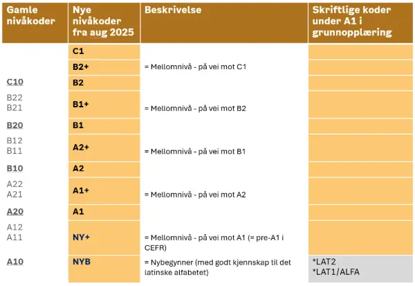
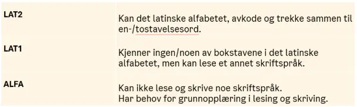

# Kartlegging og test ved inntak på servicesenteret 

## Utdanningsbakgrunn

All informasjon om utdanningsbakgrunn er selvoppgitt. Oslo voksenopplæring kan ikke kreve at søker fremviser dokumentasjon på utdanning, men alle oppfordres til å levere kopi at vitnemål hvis de har det. Hvis dokumentasjon foreligger, arkiveres den i Websak.

I kartleggingsrapporten er "Utdanning ifølge søker" utdanningsnivået i henhold til landet der utdanningen er gjennomført. Det kan være avvik mellom dette og utdanningsnivået i henhold til det norske systemet. 

### Fullført grunnskole (NG) 

Med ‘fullført grunnskole’ menes tilsvarende 9 år i grunnskole. Omfanget er ikke definert spesifikt i integreringsloven eller forskriften, men VO støtter seg til krav for inntak til vgo, som beskrevet i forarbeidene til integreringsloven, Prop 89 L, kapittel 3.2.2. 

### Fullført videregående (NV) 

Definisjon på fullført videregående skole etter integreringsforskriften:  

??? info "§ 65a.Utdanning på videregående nivå"

    Med utdanning på videregående nivå etter integreringsloven kapittel 4 og 6 menes en utdanning som oppfyller utdanningskravet på listen om Generell studiekompetanse for søkere med utenlandsk utdanning (GSU-listen). Deltageren omfattes av definisjonen i første punktum selv om vedkommende ikke tilfredsstiller språkkravet i norsk og engelsk 

    Personer med opphold etter utlendingsloven § 34 som har fullført videregående opplæring fra Ukraina, anses for å ha utdanning på videregående nivå, selv om de ikke oppfyller kravet om høyere utdanning i tillegg. 

For mange av søkere med utdanning fra utlandet innebærer utdanningskravet på GSU-lista at de har ett års universitetsutdanning i tillegg til fullført videregående skole.  

Les mer om dette – Vedlegg 1 

### Fullført høyere utdanning 

- Et fullført høgskole- eller universitetsstudium, grad eller profesjonsutdanning, 2 år eller mer 

- Ikke krav om at utdanningen tilsvarer fullført høyere utdanning i Norge 

#### Forkortelser som brukes ved registrering av utdanningsbakgrunn: 

|     |     |
| --- | --- |
| NI  | Ikke fullført grunnskole |
| NG  | Fullført grunnskole  |
| NV   | Fullført videregående skole   |
| WHED   | Listen over internasjonalt godkjente læresteder - World Higher Education Database   |
| GSU   | Generell studiekompetanse for søkere med utenlandsk utdanning   |
| VGS   | Videregående skole   |
| GS   | Grunnskole   |
| GENS   | Generell studiekompetanse   |

## Rettighet 

Følgende registreres når søker er omfattet av integreringsloven (ev. Introduksjonsloven som fortsatt gjelder for personer som fikk første oppholdstillatelse før integreringslovens ikrafttredelse 01.01.2021). 

- Lovverk: 
- Samfunnskunnskap:  
- Frist/omfang norsk:  
- Aktuell norskfrist: 

Frist for gratis norskopplæring løper fra første tilbud om opplæring jf. integreringsloven § 32 (fra første tilbudte kursdag). 

??? info "§ 32.Varighet og omfang av opplæring i norsk "

    Retten og plikten til opplæring for en deltager med oppholdstillatelse som nevnt i § 27 gjelder til deltageren har nådd et minimumsnivå i norsk etter § 31, men likevel ikke lenger enn tre år fra den datoen deltageren har fått tilbud om oppstart av opplæringen, med tillegg av godkjent permisjon. En deltager som har utdanning på videregående nivå eller høyere fra før, har ikke rett eller plikt til opplæring i lenger enn 18 måneder fra den datoen deltageren har fått tilbud om oppstart av opplæringen, med tillegg av godkjent permisjon. 

## Arbeidserfaring 

- Selvoppgitt informasjon om arbeidserfaring, arbeidspraksis e.l. 
- Både i Norge og i andre land 

## Mål 

- Utdanningsmål, yrkesmål og andre mål med opplæringen 
- For personer omfattet av integrerings- eller introduksjonsloven er disse opplysningene lovpålagt del av vedtak om norskplan 

## Samtalekartlegging 

En kort kartlegging av lese- og skriveferdigheter inngår som en del av helhetsvurdering av tidligere språklæringserfaring og forventet progresjon. 

### Førstespråk 

- Det språket/de språkene man lærte som barn. Det kan være flere språk, ev. bare muntlig. Nivået kan variere og blir ikke vurdert i samtalen. 
- Det kan også være det språket man hadde som opplæringsspråk på skolen. 

### Andrespråk 

- Språk man har lært enten på skole/kurs eller via kommunikasjon og kan bruke muntlig og/eller skriftlig. Nivået kan variere og blir ikke vurdert i samtalen. 

Skolelært: systematisk undervisning i andrespråk på skole, kurs e.l. 

### Lesehastighet 

- En lesetekst på 40 ord 
- Testen gjennomføres vanligvis med en tekst på norsk 
- Ved behov kan man bruke en tekst på engelsk, dette noteres i så fall i et merknadsfelt 
- Sier noe om kjennskap til det latinske alfabetet, uttale og avkodingsferdigheter 
- Antyder noe om erfaringer med læring 

### Skrivehastighet 

- Avskrift, antall ord per minutt 
- Teksten er på norsk 
- Sier noe om og erfaring med å bruke skriftspråk og kjennskap til det latinske alfabetet 

### Oversikt over kategoriene 

| Lesetempo 40 ord: | Skrivetempo: |
| --- | --- |
| høyt (10-40 sek) | høyt (21+ ord pr min) |
| middels (40-60 sek) | middels (10-20 ord pr min)  |
| lavt (60+ sek)  | lavt (under 10 ord pr min) |
| leser kun bokstaver  | skriver kun bokstaver  |
| kan ikke lese |  kan ikke skrive |

### Diktat

- en tekst på norsk, 3-5 setninger 
- ord- eller bokstavdiktat for personer med lite kjennskap til det latinske alfabetet 

Denne oppgaven sier noe om og personens erfaring med å bruke skriftspråk og kjennskap til det latinske alfabetet. Den viser også erfaring med å koble fonem og grafem. Kan også si noe om erfaring med andrespråkslæring for personer med førstespråk som bruker et annet skriftspråk enn latinsk alfabet. 

For andre enn nybegynnere i norsk er dette også del av kartlegging av norskkunnskaper. Det kan være relevant å vurdere tekstforståelse, rettskriving, tegnsetting m.m. 

### Digitale ferdigheter  

|     |           |
| --- | --- |
| Avansert bruker  | Kan programmere, har IT-utdanning/-arbeid.  |
| Aktiv bruker  | Bruker PC og/eller nettbrett i hverdagen, selvstendig bruker. |
| Noe erfaring   | Har brukt noe PC/nettbrett på norskkurs eller i skolen, trenger noe støtte.  |
| Lite erfaring  | Har brukt noe PC, men ikke de seneste årene. Trenger mye støtte  |
| Kun smarttelefon |  F.eks. sms/ringe/e-post/aviser/sosiale medier/kart/oversetting/Helsenorge/nettbank/NAV/spill). Trenger opplæring i bruk av PC.  |
| Ikke kartlagt  | Digitale ferdigheter er ikke vurdert.  |

For utdypende veiledning se Vedlegg 2 

## Siste vurdering av norsknivå 

- En digital Migranorsk-test gjennomføres etter kartleggingssamtalen hvis søker kan noe norsk fra før (ca. 1,5 – 2 timer) 
- Leseforståelse, lytteforståelse, skriftlig produksjon 
- Lese- og lyttedel rettes automatisk 
- Skriveoppgaven vurderes av fagkonsulent 
- Egen skrivetest på papir for søkere med lave digitale ferdigheter  
- Danner grunnlag for ‘anbefalt opplæring’  

### Nivåkoder i Oslo VO fra august 2025 

[

### Nivåkoder under A1 for grunnopplæring i lesing og skriving 

[

## Norskmål 

### Veiledende norskmål  

Norskmål fastsettes i henhold til integreringsforskriften: 

??? info "§ 28.Veiledende minimumsnivåer "

    Deltagere som ikke har fullført grunnskole fra før, bør oppnå minimum nivå A2 i delprøvene i lytteforståelse, leseforståelse og skriftlig fremstilling og nivå B1 i delprøve i muntlig kommunikasjon. 

    Deltagere som har fullført grunnskole fra før, bør oppnå minimum nivå B1 i delprøvene i lytteforståelse, leseforståelse og skriftlig fremstilling og i delprøve i muntlig kommunikasjon. 

    Deltagere som fra før har utdanning på videregående nivå eller høyere, bør oppnå minimum nivå B1 i delprøvene i lytteforståelse, leseforståelse og skriftlig fremstilling og B2 i delprøve i muntlig kommunikasjon. 

    Deltagere som fra før har utdanning på videregående nivå eller høyere, og som har behov for å dokumentere nivå B2 i alle delferdigheter, bør ha dette som norskmål. 

Norskmål kan i noen tilfelles avvike fra minimumsmålene fastsatt i forskrift, dette kommenteres i et merknadsfelt. 

- For eksempel dokumentert B1-nivå ved innsøking til norskkurs 

### Gjeldende norskmål  

- kan være i samsvar med veiledende norskmål, høyere eller lavere  
- avviker fra veiledende norskmål når disse har blitt hevet eller senket underveis 

## Modulplassering FOV 

Moduler blir fastsatt etter at fagkonsulent har vurdert resultater av inntakskartlegging i fem fag ved innsøking. Kartleggingen i samfunnsfag og naturfag foregår muntlig i inntakssamtalen. I samtalen kartlegges også noen grunnleggende ferdigheter (lese, skrive, regne og digitale ferdigheter, samt muntlig norsk).  

Det er digitale tester i norsk (ev. papirversjon) og engelsk for søkere som har noen kunnskaper i faget (se veil. om plasseringstest i norsk over). Modulplassering i norsk og engelsk er basert på Det felles europeiske rammeverket for språk. 

Vi bruker skriftlig manuell test i matematikk. Alle fagtestene er utviklet av og i samråd med lærere i Oslo VO. 

## Tilleggsopplysninger 

**Kommentar til samtalekartlegging og /eller plasseringstest. Dette kan være (listen er ikke uttømmende): **

- Begrunnelse for plassering i grunnopplæring i lesing og skriving (ALFA, LAT1 og LAT2) 
- Informasjon om tidligere norskprøver og kurs i norsk 
- Tidligere kartlagte søkere, kommentere utvikling/progresjon 
- Begrunnelse for Rask, se egen veileder Vedlegg 3 
- Selvoppgitt informasjon om behov for tilpasninger 
- Anbefaling om samtale før oppstart 
- Om samtalen er gjennomført med tolk 
- Tilleggsopplysninger om norskmål, begrunnelse når det er høyere mål enn minimumsmål 
- Beskrivelse av digitale ferdigheter 
- Kommentar til skrivetest 

## Vedlegg 1 – Om utdanning på videregående nivå 

For noen land er fullført (studieforberedende) videregående jamstilt med det samme i Norge, som da gir NV. For å kvalitetssikre dette slår vi opp landet på [GSU-lista Generell studiekompetanse](https://hkdir.no/utdanning-fra-utlandet/lister-og-databaser/generell-studiekompetanse-gsu){.glightbox}

I disse tilfellene står det slik:  

    **Utdanningskrav: **

    Én av følgende kvalifikasjoner dekker utdanningskravet: 

    [navn på fullført videregående opplæring] 
    

    [navn på fullført videregående opplæring] 

 
Fullført videregående fra noen land svarer imidlertid ikke til generell studiekompetanse i Norge. I slike tilfeller vil man se følgende under et gitt land på GSU-lista:  

    **Utdanningskrav: **

    Én av følgende kvalifikasjoner dekker utdanningskravet: 

    [navn på fullført videregående opplæring] + 1 års universitetsutdanning. 

Dette betyr at søker må ha minst ett år (i noen tilfeller to år) med høyere utdanning i tillegg til fullført videregående skole for å kunne plasseres på NV. Utdanningen må dessuten være tatt ved et internasjonalt godkjent lærested (høgskole, universitet osv.). Her bruker vi først og fremst databasen World Higher Education Database (WHED), https://whed.net/home.php. Dersom ett av lærestedene til søkeren står oppført her og hen har ett (eller ev. to) år herfra, plasseres hen som NV. 

I de tilfellene hvor videregående skole ikke er jamstilt og ingen av lærestedene finnes på WHED-lista, plasseres søkeren på NG. 

Det er likevel viktig å huske på at søkere/deltakere kan ha ulike forutsetninger for å ha mer eller mindre rask progresjon uavhengig av utdanningsbakgrunn. For å sikre tilpasset opplæring må det være rom for fleksibilitet her. 

## Vedlegg 2 - Utdypende veiledning for digital kartlegging 

### Avansert bruker 

Har høy digital kompetanse og god systemforståelse. Kan arbeide selvstendig med tekniske verktøy og problemløsing. 

#### Kjennetegn

- Har IT-utdanning eller erfaring fra teknologirelaterte arbeidsoppgaver? Avd.møte 23.6 
- Kan programmere eller forstå hvordan tekniske systemer fungerer  
- Behersker flere digitale verktøy og plattformer  
- Løser tekniske problemer uten veiledning  
- Forstår og kan forklare tekniske begreper  
- Har systemforståelse utover vanlig brukerkompetanse  
- Jobber effektivt digitalt og lærer nye systemer raskt  
- Kan støtte eller veilede andre brukere  
- Kan ha behov for introduksjon til virksomhetsspesifikke systemer  

#### Eksempler på tekniske verktøy og begreper 

- Visual Studio Code – teksteditor og utviklingsverktøy  
- MySQL – databasesystem  
- SQL – språk for å arbeide med databaser  
- GitHub – plattform for lagring og samarbeid om kode  
- Docker – verktøy for pakking og distribusjon av applikasjoner  
- Fagsystemer – eksempelvis SITS  
- ERP-systemer – systemer for økonomi, logistikk og administrasjon  
- Jira – prosjekt- og oppgavehåndtering  
- Confluence – dokumentasjon og intern kunnskapsdeling  

### Aktiv bruker 

Bruker digitale verktøy jevnlig og selvstendig i hverdagen, men uten nødvendigvis å forstå tekniske sammenhenger eller systemer i dybden. 

#### Kjennetegn

- Bruker PC, nettbrett eller smarttelefon regelmessig  
- Utfører vanlige digitale oppgaver uten hjelp  
- Bruker internett, e-post, tekstbehandling, nettbank og offentlige tjenester  
- Kan navigere mellom programmer, filer og nettleserfaner  
- Forstår grunnleggende begreper som innlogging, passord og lagring  
- Kan delta i ordinære digitale kurs uten særskilt tilrettelegging  
- Trenger sjelden hjelp i daglig bruk, men kan være usikker ved nye eller mer tekniske oppgaver  

#### Viktig skille mot avansert bruker 

En aktiv bruker kan bruke digitale verktøy effektivt, mens en avansert bruker også forstår hvordan systemene fungerer og kan feilsøke eller konfigurere dem selv. 

### Noe erfaring 

Har grunnleggende digital erfaring, men trenger støtte og veiledning for å gjennomføre oppgaver. 

#### Kjennetegn

- Har brukt PC eller nettbrett i skole, kurs eller lignende  
- Klarer enkle oppgaver med støtte  
- Er usikker på navigasjon og digitale begreper  
- Trenger steg-for-steg veiledning  
- Har behov for repetisjon og strukturert opplæring  
- Kan bli passiv uten oppfølging  

### Lite erfaring 

Har svært begrenset erfaring med PC eller har mistet tidligere ferdigheter over tid. 

#### Kjennetegn

- Har brukt PC lite eller ikke på lenge (de siste årene) 
- Har glemt en del grunnleggende PC-bruk, og trenger opplæring i det 
- Er usikker på grunnleggende funksjoner og programmer  
- Opplever digitale oppgaver som krevende  
- Har lite erfaring med digitale læringsplattformer og tester  
- Kan foretrekke papirbaserte løsninger  
- Trenger gjentatt øving og tett oppfølging  

### Kun smarttelefon 

Har erfaring med digitale tjenester via mobil, men ingen erfaring med PC. 

#### Kjennetegn

- Bruker smarttelefon aktivt i hverdagen  
- Kjenner til apper og digitale tjenester  
- Kan ha god digital forståelse på mobil  
- Har behov for opplæring i grunnleggende PC-bruk  
- Trenger støtte til bruk av mus, tastatur, filer og mapper  
- Har nytte av opplæring som bygger videre på eksisterende mobilkompetanse  

### Merknad (skal alltid fylles ut) 

Beskriv konkret hvilke digitale aktiviteter personen bruker eller mestrer. 

#### Eksempler 

- SMS, telefon-/videosamtaler (f.eks. WhatsApp) 
- E-post  
- Sosiale medier  
- Nettaviser og nyheter  
- Karttjenester 
- Oversettingsverktøy (f.eks. Google Translate) 
- Helsenorge  
- Nettbank  
- NAV  
- Digitale skjemaer eller offentlige tjenester 
- Mobilspill 

###  Ingen erfaring 

Har ingen erfaring med digitale verktøy. 

#### Kjennetegn 

- Har ikke brukt PC eller lignende teknologi tidligere  
- Kan være usikker eller engstelig i møte med teknologi  
- Kjenner ikke til mus, tastatur eller grunnleggende skjermbruk  
- Forstår ikke vanlige digitale begreper  
- Har behov for grunnleggende opplæring helt fra start  

### Ikke kartlagt 

Ingen vurdering er gjennomført. 

#### Mulige årsaker 

- Tidsmangel eller manglende prioritering  
- Kommunikasjonsutfordringer eller behov for tolk  
- Stress, usikkerhet eller andre forhold som gjør kartlegging vanskelig  
- Fokus på andre utfordringer enn digital kompetanse 

## Vedlegg 3 – Antatt RASK ved inntakskartlegging 

** Når krysse av for Antatt RASK etter inntakskartlegging  **

- Forventet å ha rask progresjon innen sin kategori (NI/NG/NV) 
    - NI, eks: 0 år vs 8 år GS 
- Helhetsinntrykk i inntakskartlegging - bør være minst to av følgende: 
    - God flyt og nokså rask leser 
    - Skriver effektivt og tydelig (håndskrift).  
    - Tid brukt på Migranorsk-test/plasseringstest 
    - Lært andrespråk, antall språk, typologisk nærhet og ev. nivå 
    - Utdanningsbakgrunn (jf. todelt i hver kategori, NI, NG og NV), hvor og på hvilke språk 
    - Tid brukt til å nå nåværende norsknivå 
- Ta i betrakting: 
    - Tilegnet seg norsk på egenhånd? 
    - Erfaring med andrespråkslæring? 
    - Motivasjon, initiativ? (vanskelig å måle) 
    - Samlet: Se på helheten (bruke skjønn) 